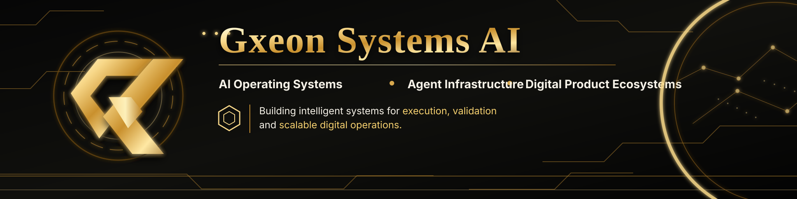
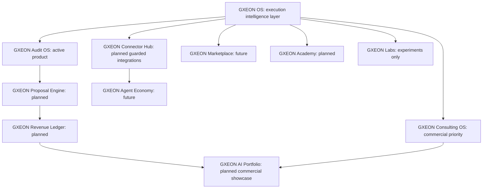
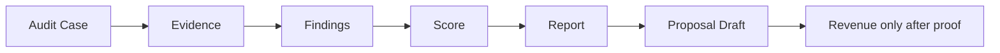
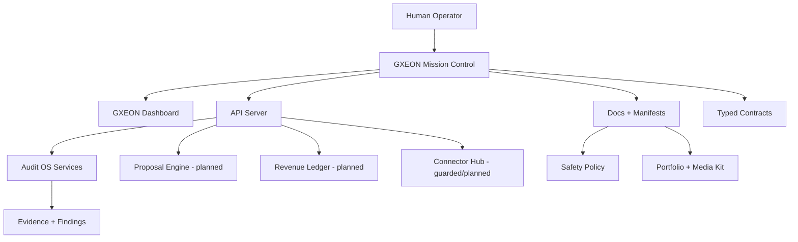

# GXEON OS

<div align="center">



## GXEON OS by Gxeon Systems AI — Execution intelligence for AI-powered digital operations

**Conversation becomes command. Command becomes code. Code becomes system. System becomes product. Product becomes revenue with proof.**

**Conversa vira comando. Comando vira código. Código vira sistema. Sistema vira produto. Produto vira receita com prova.**


</div>

---

## Executive Summary

**GXEON OS**, by **Gxeon Systems AI**, is an operating layer for AI-assisted digital execution: it captures signals, organizes opportunities, prepares missions, generates code and documentation, validates evidence, supports proposals, and tracks monetization only when proof exists.

The project is intentionally **manual-first**, **preview-first**, **safe-by-default**, and **evidence-led**. It does not claim confirmed revenue, customers, investors, autonomous production execution, unrestricted connector writes, or payment automation unless those states are proven and documented.

The current active product line is **GXEON Audit OS**, a workflow for auditing digital assets, collecting evidence, producing findings, and turning validated work into reports and proof-based offers.

> **Current launch focus:** Audit OS pilots, implementation consulting, technical collaborators, and early partner conversations.
>
> **Start here:** [Public Launch Hub](docs/gxeon-os/public-launch/PUBLIC_LAUNCH_HUB.md) · [Investor Brief](docs/gxeon-os/investors/GXEON_INVESTOR_BRIEF.md) · [One Pager](docs/gxeon-os/investors/GXEON_ONE_PAGER.md) · [Portuguese README](docs/gxeon-os/README_PTBR.md)

---

## Why GXEON Exists

AI can answer questions, but operators still need a controlled system that turns ideas into execution without losing safety, traceability, or commercial discipline. GXEON OS connects the missing layer between conversation, code, deployment, evidence, proposals, and revenue validation.

GXEON is built for founders, freelancers, agencies, technical operators, early SaaS teams, investors, partners, and collaborators who need an auditable command center instead of disconnected prompts, spreadsheets, and manual follow-up.

---

## Core Operating Loop

```text
Idea → Mission → Code → Pull Request → Deploy → Evidence → Report → Proposal → Proof-Based Revenue
```

**Rule:** revenue is not counted until there is manual proof or an approved secure integration. Planned offers, forecasts, and opportunities remain labeled as planned, projected, or unconfirmed.

---

## Ecosystem Map



Reusable source diagrams live in [`public/assets/gxeon/diagrams`](public/assets/gxeon/diagrams).

---

## What Is Already Real

| Area | Honest status | Proof in repository |
| --- | --- | --- |
| GXEON OS repository structure | Active scaffold | Monorepo folders, contracts, docs, modules |
| GXEON Audit OS | Current active product line | Audit-oriented modules and documentation |
| Safety posture | Active policy | Manual-first, preview-first, no-secrets rules |
| Documentation system | Active | Brand, investor, portfolio, security, launch and roadmap docs |
| TypeScript workspace | Active | pnpm workspace with build/typecheck scripts |
| Investor/portfolio kit | Active documentation asset | Docs and SVG assets in this repository |

---

## What Is Planned

These items are roadmap targets, not claimed production capabilities:

| Planned module | Intended role | Status label |
| --- | --- | --- |
| Proposal Engine | Convert reports into proposals and offer drafts | Planned |
| Revenue Ledger | Track forecasted, accepted, confirmed, and verified revenue | Planned |
| Connector Hub | Guarded integrations with explicit scope and approval gates | Planned |
| Academy | Playbooks, tutorials, training, and implementation materials | Planned |
| Marketplace | Templates, agents, flows, and automation packages | Future |
| SaaS | Subscription product for operators, freelancers, and agencies | Future |
| Agent Economy | Permissioned agent workflows with evidence and human approval | Future |

---

## Current Product: GXEON Audit OS

GXEON Audit OS is the first official product line. It is designed to audit websites, repositories, APIs, deploys, funnels, automations, and digital operations with evidence-first reporting.



**Golden rule:** no evidence, no report; no accepted proposal, no revenue; no proof, no monetization claim.

---

## Business Model

Initial monetization is service-led and proof-based:

| Offer | Starting target | Status |
| --- | ---: | --- |
| GXEON Express Audit | R$100 | Planned offer / proof-based |
| Complete Technical Audit | R$300 | Planned offer / proof-based |
| Audit + Assisted Fixes | R$500+ | Planned offer / proof-based |
| Operational AI Setup | R$700+ | Commercial package planned |
| GXEON Consulting OS | R$1500+ | Commercial priority |

These are initial package targets. They are not counted as revenue until real scope, customer agreement, delivery evidence, and payment proof exist.

---

## Investor-Readable Roadmap

| Phase | Milestone | Investor-readable outcome |
| --- | --- | --- |
| P0 | Foundation | Repository, contracts, safety policy, docs, brand and portfolio kit |
| P1 | Audit OS | Evidence-led audit workflow and report foundation |
| P2 | Proposal Engine | Report-to-offer conversion with human approval |
| P3 | Revenue Ledger | Proof-required monetization tracking |
| P4 | Portfolio + Consulting OS | Public showcase and service packaging |
| P5 | Academy | Repeatable training and playbooks |
| P6 | Connector Hub | Scoped integrations with preview/write guards |
| P7 | Marketplace | Sellable templates, agents, and workflows |
| P8 | SaaS | Subscription platform layer |
| P9 | Agent Economy | Governed agent execution with permissions and evidence |

---

## Live Architecture



---

## Public Launch Resources

| Resource | Link |
| --- | --- |
| Public Launch Hub | [docs/gxeon-os/public-launch/PUBLIC_LAUNCH_HUB.md](docs/gxeon-os/public-launch/PUBLIC_LAUNCH_HUB.md) |
