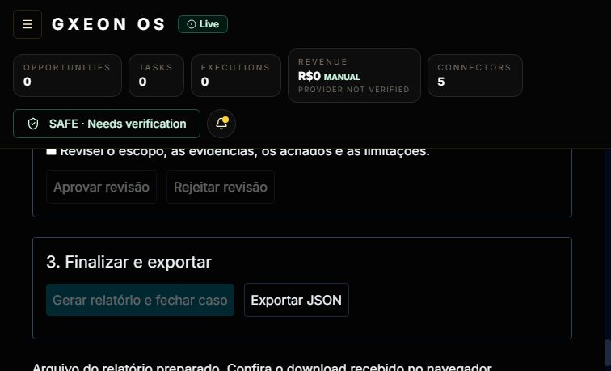

# GX-01.6 — exportação real

**BLOCKED — recebimento do arquivo pelo navegador não comprovado.** Em 24/10 a ferramenta conseguiu abrir a UI real em http://127.0.0.1:5174/audit-os, carregar o caso CLOSED por token de teste e acionar Exportar JSON. A tela mostrou “Arquivo do relatório preparado. Confira o download recebido no navegador.” Uma evidência visual não prova o recebimento.

O evento de download da API documentada do navegador expirou em 20s; uma segunda tentativa terminou em timeout de 30s e reinicializou a sessão de automação. Não foi obtido caminho de arquivo recebido. Nenhum acesso ao perfil/Downloads, CDP alternativo ou contorno de restrição foi usado. Token foi limpo da tela. UI acessível é avanço parcial; browserDownloadVerified=false permanece correto.

O caso foi criado/rodado/revisado/fechado via verificações HTTP de staging com dados sintéticos, e depois carregado na UI. Não alegar que todos os passos de criação/revisão foram clicados por humano. [API report](evidence/local-api-report.json) não satisfaz este gate. [Recovery](evidence/local-recovery-failures.json) tem matchesPersistedRecord=true para o JSON de API apenas.

Procedimento manual em ambiente isolado autorizado:

1. Instalar lock congelado e build de libs/apps. pnpm run stage:audit init e up em NOVO ambiente; não reinicializar volume existente. pnpm run verify:audit-staging cria fixtures explicitamente TEST DATA e preserva CLOSED.
2. Abrir a UI; carregar o ID em .gx012/evidence/api-report.json usando token de teste mantido local, nunca em URL/log. Para comprovar também lifecycle pela UI, criar caso autorizado com vercel.json sanitizado; selecionar os dois checks; executar; trocar para credencial reviewer distinta, registrar referência de revisão de teste e depois finalizar como operator. Revisão automática/teste não é aceite independente.
3. Clicar Exportar JSON e confirmar arquivo recebido no próprio navegador. Registrar filename/caminho autorizado, horário, tamanho e SHA256; nunca gerar cópia da API em substituição.
4. Executar node scripts/audit-staging/verify-report.mjs "CAMINHO_AUTORIZADO_DO_ARQUIVO". Guardar saída sanitizada com matchesPersistedRecord=true e hash.
5. Reiniciar a instância própria via pnpm run stage:audit restart. Reexecutar o mesmo comando sobre O MESMO arquivo recebido, comparar IDs/hash/estado e referências; salvar prova.
6. Registrar pessoa/ambiente/commit e screenshot sem token. Gate D só fecha com os dois resultados e recibo real. Não executar contra produção.

Arquivo recebido, verificador antes/depois e aprovação humana: **NOT TESTED / BLOCKED**. Não há substituição por ZIP de CI.
